# Awesome Application & System Monitoring 🚀

  

 

**A curated list of elite Application Performance Monitoring (APM), Infrastructure Telemetry, Distributed Tracing, Log Analytics & Full-Stack Observability tools.**

*Focused on OpenTelemetry, Cloud-Native Systems, Kubernetes Diagnostics, and Real-Time Production Reliability.*

🌟 **Star the repository if you find this guide valuable!** 🌟

---

## 📑 Table of Contents

- [🔭 Sector Overview & Market Dynamics](#-sector-overview--market-dynamics)
- [🏢 Enterprise SaaS & Hosted Observability Platforms](#-enterprise-saas--hosted-observability-platforms)
- [💻 Top Open-Source GitHub Projects](#-top-open-source-github-projects)
- [🌟 Star History](#-star-history)
- [🤝 How to Contribute](#-how-to-contribute)
- [💖 Support & Sponsorship](#-support--sponsorship)
- [⚖️ Disclaimer & Guidance](#-disclaimer--guidance)

---

## 🔭 Sector Overview & Market Dynamics

The global Application Performance Monitoring (APM) and full-stack observability market is estimated at **$10.3B–$11.9B in 2026** and projected to exceed **$25B+ by the early 2030s** (~11–15% CAGR), accelerated by cloud-native microservices, containerization, and AI-driven telemetry. 

The sector is **moderately fragmented**:
- **Consolidation at the Enterprise Core**: Tier-1 enterprise wallet share remains heavily concentrated among a few dominant full-stack platform leaders (**Datadog**, **Cisco AppDynamics / Splunk**, and **Dynatrace**) that offer turnkey, unified correlation across metrics, logs, traces, and automated root-cause analysis.
- **Democratization via OpenTelemetry & Open-Source**: The industry-wide adoption of **OpenTelemetry (OTel)** has standardized telemetry data collection, ending proprietary agent lock-in. This enables high fragmentation across specialized storage backends (e.g., ClickHouse, VictoriaMetrics), open visualization layers (Grafana), and purpose-built uptime engines that prevent a total winner-take-all monopoly.

---

## 🏢 Enterprise SaaS & Hosted Observability Platforms

Comprehensive cloud platforms providing managed infrastructure, auto-instrumentation, and full-stack telemetry correlation. Sorted by parent company **Market Capitalization / Valuation (Descending)**:

| Company / Product | Valuation / Revenue 💰 | Starting Pricing Tier 🏷️ | Free Tier Limits / Free Trial ⏳ | Best For 🎯 |
|---|---|---|---|---|
| **[AppDynamics](https://www.appdynamics.com/)** *(Cisco Systems)* | **~$413B Market Cap** *(Parent Cisco; ~$54B annual revenue)* | **$6 / vCPU / month** (Infrastructure Monitoring Edition; APM starts at $33/month, billed annually) | **30-day free trial** (Full Pro access; converts to Lite mode limited to 1 agent/language & 24h data retention) | Enterprises with complex hybrid application landscapes needing deep transaction tracing and Cisco ecosystem support. |
| **[Datadog](https://www.datadoghq.com/)** | **~$95B–$100B Market Cap** *(NASDAQ: DDOG; ~$2.7B+ ARR)* | **$15 / host / month** (Infrastructure Pro, billed annually; $18 month-to-month; APM from $31/host/mo) | **Free tier up to 5 hosts** (1-day metric retention); or **14-day free trial** with full feature access | Teams wanting the broadest integration ecosystem (800+ integrations) and a single platform for all telemetry signals. |
| **[Atlassian Monitoring / Opsgenie](https://www.atlassian.com/)** | **~$52B–$55B Market Cap** *(NASDAQ: TEAM; ~$4.4B annual revenue)* | **$9.45 / user / month** (Opsgenie Essentials; or Jira Service Management Standard at $22.05/agent/mo) | **Free forever plan up to 5 users** (basic alerting & on-call); or **14-day free trial** for higher plans | Atlassian-centric teams wanting tightly coupled incident management, on-call alerting, and status pages. |
| **[Dynatrace](https://www.dynatrace.com/)** | **~$17B–$18.5B Market Cap** *(NYSE: DT; ~$1.5B+ annual revenue)* | **$0.01 / host-hour** (~$7/month per host for Foundation; Infrastructure at $0.04/hr, Full-Stack APM from $0.01/GiB-RAM/hr) | **15-day free trial** (Full platform evaluation; data retained 30 days post-expiration; also preloaded sandbox playground) | Enterprises wanting automated topology discovery and deterministic, AI-driven root cause analysis (Davis AI). |
| **[Site24x7](https://www.site24x7.com/)** *(Zoho Corporation)* | **~$12.5B Valuation** *(Parent Zoho; ~$1.5B annual revenue)* | **$9 / month** (Starter/Lite plan billed annually; $10 month-to-month for up to 10 basic monitors) | **Free forever plan up to 50 website monitors** (5-minute polling interval, 1 status page, email alerts); or **30-day free trial** for full APM | SMBs, startups, and webmasters wanting an affordable, feature-packed monitoring suite across websites and servers. |
| **[Elastic Observability](https://www.elastic.co/observability)** | **~$10.5B Market Cap** *(NYSE: ESTC; ~$1.4B annual revenue)* | **$95 / month** (Elastic Cloud Hosted Standard; or Serverless usage-based starting at ~$0.07/GB ingested) | **14-day free trial** (Elastic Cloud hosted & serverless; 30-day grace period post-trial, no credit card required) | Organizations already invested in Elasticsearch looking for unified search-powered log analytics and APM. |
| **[Grafana Cloud](https://grafana.com/)** *(Grafana Labs)* | **$9B Valuation** *(Series E; ~$600M+ ARR)* | **$19 / month** (Grafana Cloud Pro base platform fee, includes 3 users, 10k metric series, 50 GB logs/traces) | **Free forever plan: 10,000 active metric series, 50 GB logs, 50 GB traces, 3 users**, 14-day data retention | Engineering teams already using Grafana wanting managed Prometheus, Loki, and Tempo without managing infrastructure. |
| **[New Relic](https://newrelic.com/)** | **$6.5B Valuation** *(Acquired by Francisco Partners & TPG)* | **$10 / month** for 1st full platform user + usage ($0.40/GB ingested beyond free allowance; $99/mo for additional users) | **Free forever plan: 100 GB/month data ingest**, 1 full platform user, unlimited basic users | Developers wanting transparent usage-based billing with full-stack APM, infrastructure, and browser tracing. |
| **[SolarWinds Observability](https://www.solarwinds.com/)** | **~$3.2B Valuation** *(Turn/River Capital take-private; ~$780M revenue)* | **$15.75 / node / month** (Network & Infrastructure Observability SaaS module; Application Observability from $27.50/service/mo) | **30-day free trial** (Full hybrid-IT visibility including traces, metrics, logs, and APM; no credit card required) | Enterprise IT teams wanting hybrid infrastructure, network, and system monitoring from an established vendor. |
| **[LogicMonitor](https://www.logicmonitor.com/)** | **$2.4B Valuation** *(Vista Equity / PSG; ~$400M ARR)* | **$16 / hybrid unit / month** (Essentials tier; Advanced tier at $27/hybrid unit/mo, metered by monitored resource) | **15-day free trial** (Full platform access across Essentials/Advanced tiers for non-production environments) | IT operations and MSP teams needing automated hybrid cloud discovery and multi-tenant infrastructure coverage. |

---

## 💻 Top Open-Source GitHub Projects

Leading open-source projects for self-hosted observability, APM, distributed tracing, metrics, and system monitoring. Sorted by **GitHub Star Count (Descending)** with dynamic live star badges linked directly to each project's stargazers page:

- **[Uptime Kuma](https://github.com/louislam/uptime-kuma)** 
  - 🛠️ **Focus**: Self-hosted uptime, ping, HTTP(s), DNS, Docker monitoring & incident status pages.
  - 📜 **License**: MIT
  - ⚡ **Features**: Real-time response timing graphs, multi-region ping, 90+ notification dispatchers (Telegram, Discord, Slack, Webhooks), certificate monitoring, and responsive public status pages.
  - 🎯 **Best for**: SREs and DevOps teams wanting a lightweight, self-hosted status dashboard and uptime monitor without infrastructure overhead.

- **[Netdata](https://github.com/netdata/netdata)** 
  - 🛠️ **Focus**: Real-time per-second infrastructure monitoring and automated diagnostics.
  - 📜 **License**: GPL-3.0
  - ⚡ **Features**: Zero-configuration per-second metric streaming, hundreds of auto-detected integrations (CPU, RAM, disks, network, containers, databases), machine-learning anomaly detection, and embedded web dashboards.
  - 🎯 **Best for**: Immediate high-resolution system performance troubleshooting across bare-metal servers, VMs, and IoT devices.

- **[Grafana](https://github.com/grafana/grafana)** 
  - 🛠️ **Focus**: Open and composable observability and analytics visualization platform.
  - 📜 **License**: AGPL-3.0
  - ⚡ **Features**: Industry-standard data visualization engine connecting to Prometheus, Loki, Tempo, OpenTelemetry, Elasticsearch, PostgreSQL, and InfluxDB with rich dashboards, alerting, and plugins.
  - 🎯 **Best for**: Teams seeking a central pane of glass for all operational metrics, logs, and distributed traces.

- **[Prometheus](https://github.com/prometheus/prometheus)** 
  - 🛠️ **Focus**: Time-series database, metrics collection engine, and alerting system (CNCF Graduated).
  - 📜 **License**: Apache-2.0
  - ⚡ **Features**: Multi-dimensional data model with metric names and key/value pairs, powerful PromQL query language, efficient pull-based telemetry collection via HTTP scraping, and Alertmanager routing.
  - 🎯 **Best for**: Kubernetes monitoring and cloud-native systems requiring standardized, robust service metrics.

- **[Glances](https://github.com/nicolargo/glances)** 
  - 🛠️ **Focus**: Cross-platform curses-based system monitoring tool with CLI, Web UI, and API modes.
  - 📜 **License**: LGPL-3.0
  - ⚡ **Features**: Monitors CPU, memory, load, processes, disk I/O, network interfaces, sensors, and Docker containers; dynamically scales output to fit terminal dimensions; provides REST/XML-RPC endpoints.
  - 🎯 **Best for**: Developers and sysadmins seeking a quick, zero-friction `top`/`htop` alternative with a built-in browser interface.

- **[SigNoz](https://github.com/SigNoz/signoz)** 
  - 🛠️ **Focus**: OpenTelemetry-native full-stack APM and observability platform.
  - 📜 **License**: MIT / Non-commercial enterprise modules
  - ⚡ **Features**: Out-of-the-box APM metrics (p99 latency, error rate, throughput), ClickHouse-backed blazing-fast log management, distributed tracing with flamegraphs, PromQL support, and exception monitoring.
  - 🎯 **Best for**: Teams seeking a modern, production-ready, open-source alternative to Datadog and New Relic without per-host licensing fees.

- **[Apache SkyWalking](https://github.com/apache/skywalking)** 
  - 🛠️ **Focus**: Application Performance Monitoring (APM) and observability analysis for distributed microservices.
  - 📜 **License**: Apache-2.0
  - ⚡ **Features**: Multi-language auto-instrumentation agents (Java, .NET, Node.js, Go, Python, PHP, C++), eBPF-powered network and CPU profiling (Rover), service topology mapping, BanyanDB native storage, and 100B+ telemetry data point scale.
  - 🎯 **Best for**: Large enterprises running complex, multi-language microservices and Kubernetes clusters at massive scale.

- **[Jaeger](https://github.com/jaegertracing/jaeger)** 
  - 🛠️ **Focus**: CNCF-graduated distributed tracing platform.
  - 📜 **License**: Apache-2.0
  - ⚡ **Features**: High-throughput distributed context propagation, transaction monitoring, service dependency analysis, root-cause diagnostics, and OpenTelemetry OTLP trace ingestion.
  - 🎯 **Best for**: Diagnosing distributed microservice latencies, bottlenecks, and complex RPC inter-service requests.

- **[VictoriaMetrics](https://github.com/VictoriaMetrics/VictoriaMetrics)** 
  - 🛠️ **Focus**: High-performance, cost-effective time-series database and monitoring solution.
  - 📜 **License**: Apache-2.0
  - ⚡ **Features**: Drop-in replacement for Prometheus with full PromQL/MetricsQL compatibility, 10x lower RAM/disk footprint, extreme compression, high write throughput, and long-term storage scaling.
  - 🎯 **Best for**: Teams struggling with Prometheus resource consumption and seeking high-scale long-term metrics storage.

- **[Apache Zipkin](https://github.com/openzipkin/zipkin)** 
  - 🛠️ **Focus**: Lightweight distributed tracing system and latency diagnosis framework.
  - 📜 **License**: Apache-2.0
  - ⚡ **Features**: Trace collection and lookups, B3 propagation compatibility, OpenTelemetry span ingestion, service dependency graphing, and pluggable backends (Cassandra, Elasticsearch, MySQL).
  - 🎯 **Best for**: Teams needing a proven, lightweight tracing backend that integrates easily into existing architectures.

- **[Checkmate](https://github.com/bluewave-labs/Checkmate)** 
  - 🛠️ **Focus**: Self-hosted server hardware, uptime, response time, and incident tracker.
  - 📜 **License**: AGPL-3.0
  - ⚡ **Features**: Sleek UI dashboards, CPU/RAM/disk/temperature telemetry, Docker container health, SSL verification, ping metrics, and email alerting.
  - 🎯 **Best for**: Sysadmins wanting an elegant, visual server health and uptime monitor without heavy observability infrastructure.

- **[OpenTelemetry Collector](https://github.com/open-telemetry/opentelemetry-collector)** 
  - 🛠️ **Focus**: Vendor-neutral proxy and telemetry processing pipeline for traces, metrics, and logs.
  - 📜 **License**: Apache-2.0
  - ⚡ **Features**: Ingests, batches, filters, transforms, and exports telemetry in OTLP, Prometheus, Zipkin, Jaeger, and proprietary formats; eliminates vendor lock-in.
  - 🎯 **Best for**: Any modern observability architecture wishing to route telemetry simultaneously to multiple backends.

- **[Zabbix](https://github.com/zabbix/zabbix)** 
  - 🛠️ **Focus**: Enterprise-grade distributed monitoring platform for network devices, servers, and clouds.
  - 📜 **License**: AGPL-3.0
  - ⚡ **Features**: Agent and agentless data collection (SNMP, IPMI, JMX), multi-tenant monitoring, flexible trigger definitions, SLA reporting, and high scalability across thousands of nodes.
  - 🎯 **Best for**: Enterprise network operations centers (NOC) and hybrid enterprise IT infrastructure.

- **[CheckCle](https://github.com/operacle/checkcle)** 
  - 🛠️ **Focus**: Self-hosted full-stack monitoring and regional uptime platform.
  - 📜 **License**: MIT
  - ⚡ **Features**: Distributed HTTP, DNS, Ping, and TCP checks; SSL expiry alerts; one-line agent for Linux/Windows host telemetry (CPU, RAM, storage); public status pages; multi-channel alerts (Slack, Discord, Telegram, Matrix).
  - 🎯 **Best for**: Web engineering teams needing comprehensive uptime tracking with public status pages and server metric integration.

- **[Pandora FMS](https://github.com/pandorafms/pandorafms)** 
  - 🛠️ **Focus**: All-in-one general-purpose monitoring software for networks, servers, and applications.
  - 📜 **License**: GPL-2.0 / Open Project
  - ⚡ **Features**: Comprehensive monitoring of heterogeneous environments, WMI, NetFlow, SNMP traps, log collection, and reporting within a unified console.
  - 🎯 **Best for**: Mixed legacy and modern environments seeking broad infrastructure coverage in a single suite.

- **[Monitrix](https://github.com/ezeslucky/monitrix)** 
  - 🛠️ **Focus**: OpenTelemetry-native open-source APM and observability platform.
  - 📜 **License**: AGPL-3.0
  - ⚡ **Features**: APM dashboarding (p99 latency, Apdex, error rates), distributed tracing with flamegraphs, ClickHouse log management, and OpenTelemetry instrumentation compatibility.
  - 🎯 **Best for**: Developers exploring newer lightweight, OpenTelemetry-first APM alternatives.

---

## 🌟 Star History

---

## 🤝 How to Contribute

Contributions to expand and update this curated list are very welcome! 

1. 🍴 **Fork the repository**.
2. 🌿 **Create a descriptive feature branch** (`git checkout -b add-monitoring-tool`).
3. ✍️ **Add or refine an entry** in `README.md` keeping descriptions factual, concise, and adhering to the table or open-source list format.
4. 🚀 **Commit your changes** (`git commit -m "Add ToolName (category)"`).
5. 📬 **Submit a Pull Request** with a clear explanation of why the tool belongs in this list.

---

## 💖 Support & Sponsorship

Thank you for exploring and utilizing **Awesome-Application-System-Monitoring**! If this curated guide helps your engineering team choose the right observability and APM stack, please consider supporting the project:

- 🌟 **Star the repository** to boost visibility for the developer community.
- 🍴 **Fork and share** the project with DevOps, SRE, and platform engineers.
- ☕ **Buy a coffee & sponsor ongoing maintenance** via the [GitHub Sponsor Dashboard](https://github.com/sponsors/ishandutta2007).

Your support enables continuous tracking, benchmarking, and updates across the rapidly evolving observability landscape!

---

## ⚖️ Disclaimer & Guidance

- **Community-Curated**: This repository is maintained as a community resource and does not represent an endorsement of any commercial platform or vendor.
- **Architectural Scope**: Choosing between full-stack observability suites (Datadog, Dynatrace, SigNoz), distributed tracing backends (Jaeger, Zipkin), time-series metrics engines (Prometheus, VictoriaMetrics), and uptime diagnostics (Uptime Kuma, CheckCle) depends on whether you require unified APM correlation, deep microservice tracing, or server availability.
- **Data Privacy & Compliance**: Monitoring systems ingest production telemetry that may contain sensitive user parameters or infrastructure secrets. Ensure that your log filtering, masking, and OpenTelemetry collector processors adhere to strict privacy policies (GDPR, HIPAA, CCPA) prior to production deployment.

---

**Built with ❤️ for developers, DevOps engineers, and SREs architecting high-reliability systems.**

